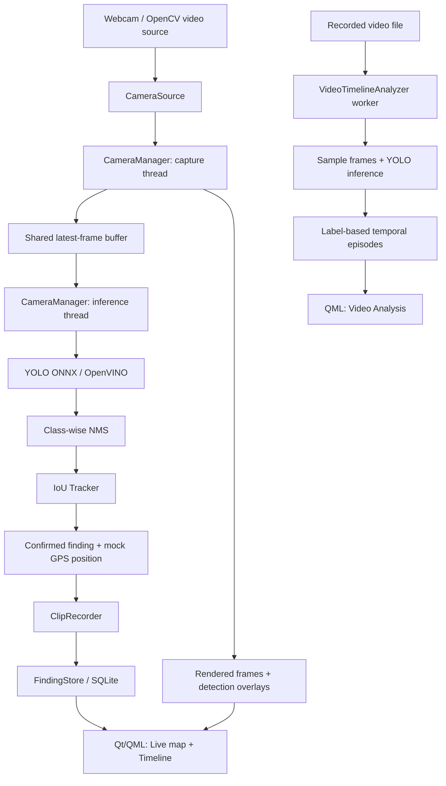

# Live Tracker

**Real-time object detection, tracking, and video event exploration in C++ and Qt.**

Live Tracker is an experimental desktop application combining **Qt/QML**, **OpenCV**, **YOLO inference with OpenVINO**, and **SQLite**. It processes camera frames, identifies and tracks detected objects, records short clips around confirmed detections, and lets users explore the findings on a map and a timeline.

It also includes an **offline video-analysis workspace** that extracts and visualizes detection events from recorded footage.

> **Project status:** Working prototype / ongoing development. Geographical coordinates are **currently simulated**; the GPS hardware integration and edge-device setup described below are future goals. The available code has not been independently benchmarked or validated on an actual drone/vehicle deployment.

## Features

### Live video and object detection

- Desktop interface implemented in **Qt 6 / QML** with a C++ application core.
- Webcam acquisition using OpenCV's `VideoCapture`.
- YOLO model inference from an **ONNX** model using **OpenVINO Runtime**.
- Image preprocessing, prediction decoding, bounding-box reconstruction, and **class-wise non-maximum suppression (NMS)** implemented in C++.
- Custom object tracking using **Intersection over Union (IoU)**, track IDs, confirmation thresholds, and stale-track removal.
- Separate threads for frame acquisition and model inference, with mutex-protected shared frame and detection buffers.
- Automatic recording of short video clips when new tracks are confirmed.

### Finding exploration

- Persistent detection history backed by **SQLite** and exposed to QML through `QAbstractListModel`.
- Interactive **OpenStreetMap** map with finding pins and a synchronized detection list.
- Filtering by class, confidence, and time range, with a map-based geographic selection area.
- Chronological timeline for browsing and selecting findings.
- Clip playback and export support.

**Location note:** Finding positions currently come from a mock GPS provider. Map pins and region filtering are functional UI features, but they do not yet represent real GNSS measurements.

### Recorded-video analysis

- Load a local video and run object detection on sampled frames.
- Group nearby detections of the **same class** into temporal episodes, avoiding one event per frame.
- Browse episodes using a timeline, thumbnails, confidence information, and video playback controls.
- Cancel an analysis, follow its progress, and inspect partial results.

**Important distinction:** Offline episodes are grouped by **class label**, not by persistent object identity. Live camera tracking uses a separate IoU-based tracker.

## Technology stack

| Area | Technologies |
| --- | --- |
| Application | C++, Qt 6, QML, CMake |
| Computer vision | OpenCV, YOLO, ONNX |
| Inference | OpenVINO Runtime (with an alternative OpenCV DNN path in the code) |
| Concurrency | `std::thread`, `std::mutex`, `std::atomic` |
| Persistence | SQLite, Qt SQL, `QAbstractListModel` |
| Maps and media | Qt Location, OpenStreetMap, Qt Multimedia |

## Architecture

The live pipeline keeps image capture, inference, event recording, and user-interface updates in separate components.



### Main components

| Component | Responsibility |
| --- | --- |
| `CameraSource` | Opens a webcam or OpenCV-compatible source and reads frames. |
| `CameraManager` | Coordinates capture, inference, overlays, clipping, and Qt signals. |
| `YoloModel` | Loads the ONNX model, runs OpenVINO inference, decodes predictions, and applies per-class NMS. |
| `Tracker` | Associates detections across frames with IoU and emits newly confirmed tracks. |
| `ClipRecorder` | Writes short MP4 recordings for detected events. |
| `FindingStore` | Stores detection metadata in SQLite and exposes it to QML. |
| `VideoTimelineAnalyzer` | Processes saved videos asynchronously into class-based temporal events. |
| `MapDisplay` / `TimelineView` | Displays, filters, and explores stored findings. |

## Key engineering details

### Object tracking

The live tracker associates bounding boxes from consecutive frames using their **IoU overlap**. It matches detections only within the same class, prioritizes higher-overlap pairs, assigns IDs to unmatched detections, and removes tracks that have not been updated for a configurable number of frames. A track must be observed repeatedly before triggering a finding.

This is a lightweight, custom tracker rather than an implementation of SORT, DeepSORT, or ByteTrack.

### Threading and UI responsiveness

Live capture and inference use distinct C++ threads. Shared frame data and inference results are protected with mutexes, and changes to the Qt interface are signalled to the main thread. Offline analysis runs on a worker thread with cancellation and progress reporting.

### Offline event extraction

The offline analyzer samples frames at a configured frequency (**2 samples per second** in the current implementation). Detections of the same label that occur close together in time are merged into an episode; short-lived episodes can be discarded. This improves timeline readability, but it is intentionally **not per-object multi-object tracking**.

## Build and run

### Requirements

- CMake **3.16+** and a compatible C++ compiler.
- **Qt 6.8+**, including Qt Quick, Quick Controls 2, Location, Positioning, Multimedia, and SQL modules.
- **OpenCV** with video I/O and DNN support.
- **OpenVINO Runtime**.
- A camera for the live view, or a local video file for offline analysis.

The repository includes a YOLO ONNX model under `models/`. Actual inference speed and video format support depend on your hardware, OpenCV build, and runtime configuration.

```bash
git clone https://github.com/Bessouat40/live-tracker.git
cd live-tracker

cmake -S . -B build -DCMAKE_BUILD_TYPE=Release
cmake --build build --parallel
```

**Launch from the build directory**: the application loads its model using the relative path `models/yolo26n.onnx`, and CMake copies `models/` there during configuration.

```bash
cd build

# Linux (depending on the chosen CMake generator)
./applive-tracker

# macOS (Qt application bundle)
./applive-tracker.app/Contents/MacOS/applive-tracker
```

> These are expected build/run commands based on `CMakeLists.txt`; they have not been tested across every OS or dependency setup. If CMake cannot locate Qt, OpenCV, or OpenVINO, configure their package installation paths according to your environment.

### Using the app

1. Open **Live** and select your webcam, then start the stream.
2. Observe object detections and confirmed findings; inspect clips and map pins in the side panel.
3. Open **Timeline** to filter saved findings by label, confidence, time, or geographic area.
4. Open **Video Analysis**, select a local video, and analyze it to build a temporal event view.

**Network streams:** `CameraSource` accepts a string source compatible with OpenCV (for example, an RTSP URL). However, the current QML custom-URL handler still needs to be wired to `CameraViewer.setSourcePath()`; this input should be considered **in progress** until that is fixed and tested.

## Project structure

```text
live-tracker/
├── CMakeLists.txt
├── Main.qml
├── main.cpp
├── models/                     # YOLO ONNX model + labels
├── src/
│   ├── camera_source.*         # Frame acquisition
│   ├── camera_manager.*        # Live capture and inference coordination
│   ├── detection/
│   │   ├── yolo_model.*        # ONNX/OpenVINO inference and NMS
│   │   ├── tracker.*           # IoU-based multi-object tracking
│   │   └── video_timeline_analyzer.*
│   ├── position/gps.*          # Mock GPS provider (for now)
│   ├── stores/finding_store.*  # SQLite-backed finding model
│   └── utils/                  # Video recording and overlays
└── qml/
    ├── LiveComponents/
    ├── TimelineComponents/
    ├── SharedComponents/
    └── Singletons/
```

## Planned improvements

- [ ] Replace mock coordinates with a real GPS/GNSS input and synchronize positions with video frames.
- [ ] Fix and test custom network-stream selection in the QML interface.
- [ ] Validate an edge-node/base-station configuration with a camera and mobile GPS-equipped device.
- [ ] Add automated unit and integration tests for inference post-processing, tracking, and persistence.
- [ ] Benchmark latency, throughput, and memory usage across supported hardware.
- [ ] Improve recovery and logging for disconnected streams and device failures.

## Intended hardware architecture (future deployment)

The long-term design separates a lightweight mobile **edge node** (camera, GPS receiver, SBC, wireless link) from a **base station** running the Qt application and the inference model. This architecture is a proposed deployment target, **not a currently demonstrated hardware integration**.

## Scope

Live Tracker is a personal engineering project exploring **C++ application architecture, real-time video processing, model inference, multi-object tracking, and geospatial visualization**. It is not a validated safety-critical or autonomous navigation system.
